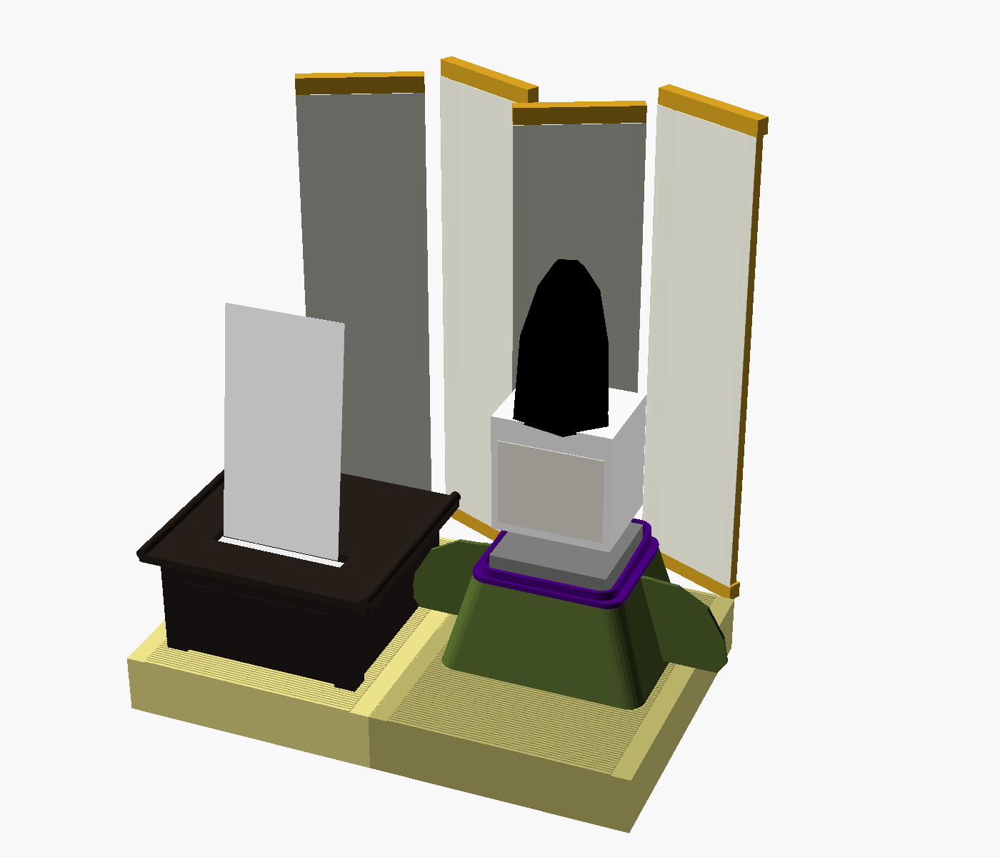
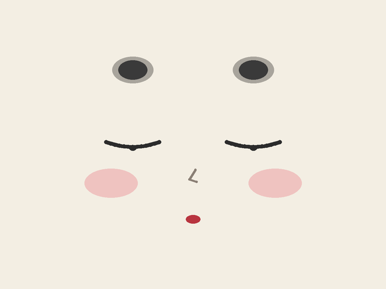
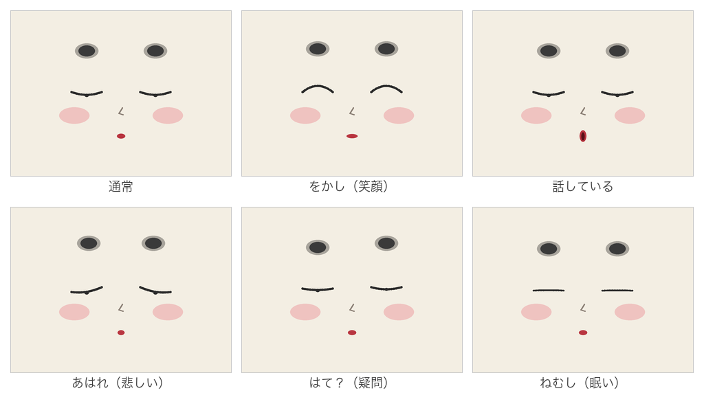

# 平安俳句ｽﾀｯｸﾁｬﾝ（仮称：文麿 / ふみまろ）

サークル制作の俳句ゲームのイベントで、来場者の一句を**短冊にして手渡す**付き人ロボット。
平安装束のｽﾀｯｸﾁｬﾝが文机に向かい、ミニ感熱プリンタで短冊を「したためて」献上する。



*完成イメージ（3Dモデルのレンダリング。ｽﾀｯｸﾁｬﾝ本体は箱で代用、装束の布は未表現）*

## ドキュメント
- [docs/concept.md](docs/concept.md) — 全体構想（体験の流れ・ハード/ソフト構成・開発ステップ）
- [docs/decoration.md](docs/decoration.md) — 装飾の詳細設計（衣装・顔・調度品・短冊デザイン・部品表）
- [docs/enclosure.md](docs/enclosure.md) — 筐体設計（A1 mini で印刷する部品・布の型紙・組み立て順）
- [docs/software.md](docs/software.md) — ソフトウェア構成（接客の流れ・ゲーム連携API・実装の順番）

## 機材
- M5Stack CoreS3 + Feetech SCS0009 ×2（パン/チルト）
- 感熱プリンタ: BluwieBroka S1（84×84×43mm、57mm紙、203dpi、BLE、アプリ「Luck Jingle」）
  - ⚠ ESP32 から BLE で直接制御できるかは未検証（プロトコル解析が必要）、Amazonで適当に調べて一番上に出ただけだからより良いものがあればそれにするかも
- 3Dプリンタ

## 顔
『源氏物語絵巻』の**引目鉤鼻**（細い線の目と「く」の字の鼻）に、額の高い位置の**置眉**、紅の小さな口、頬紅を合わせた平安顔（[src/HeianFace.h](src/HeianFace.h)）。





*CoreS3 の画面（320×240）と同じ座標・色で描き出したイメージ（[tools/render_face.py](tools/render_face.py)）*

## ファームウェア
- 平安顔の Avatar（[src/HeianFace.h](src/HeianFace.h)）：引目鉤鼻・置眉・紅の口・頬紅
- 画面をタッチすると、ずんだもんの声でセリフを順に話す（音量に合わせて口パク）

```bash
pio run -t upload
```

### セリフを変えるとき
1. [voice/phrases.json](voice/phrases.json) を編集
2. VOICEVOX エンジンを起動して音声を生成（`assets/voices.bin` と `src/voice_table.h` が更新される）
```bash
docker run --rm -d -p 127.0.0.1:50021:50021 --name voicevox voicevox/voicevox_engine:cpu-latest
```
```bash
python3 tools/gen_voices.py
```
3. 書き込み直す

## クレジット
- 音声：**VOICEVOX:ずんだもん**（[VOICEVOX](https://voicevox.hiroshiba.jp/)）。展示や公開の際もこの表記を入れること
- 3Dモデル：ｽﾀｯｸﾁｬﾝ タカオ版（Apache 2.0、`cad/reference/takao/LICENSE`）

## フォルダ構成
- `voice/` … セリフ一覧（音声生成の元データ）
- `tools/` … 音声生成スクリプト
- `assets/` … 埋め込み用の音声データ（自動生成）
- `src/` … ファームウェア（`~/Desktop/StackChan` のステップ1から派生）
- `cad/reference/takao/` … ｽﾀｯｸﾁｬﾝ takao 版 STL（参照用・ライセンスは同梱 LICENSE に従う）
- `cad/heian/` … オリジナル部品の OpenSCAD モデル・STL・プレビュー画像
