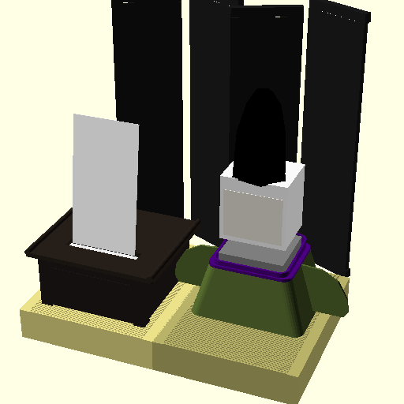
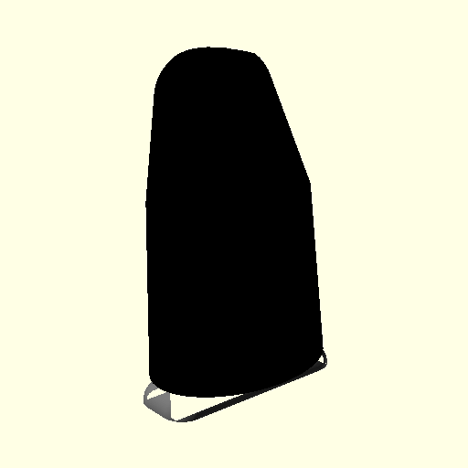
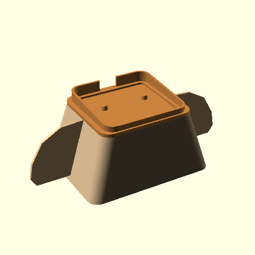
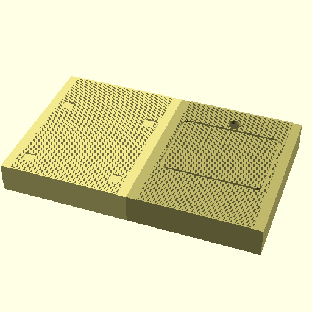
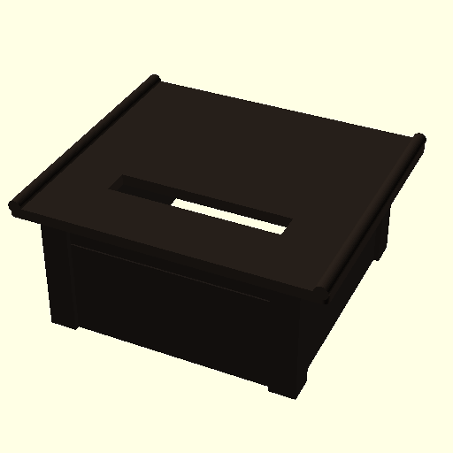

# 筐体設計（3Dプリント ＋ 布）v0.1

Bambu Lab **A1 mini（造形サイズ 180×180×180mm）** で全部品が印刷できるように設計した。
モデルはすべて OpenSCAD のパラメトリックモデル（[cad/heian/](../cad/heian/)）。寸法を変えるときは各 `.scad` の先頭にある数値を直して、STL を書き出し直す。



## 1. 構造の考え方

ｽﾀｯｸﾁｬﾝは「頭（CoreS3）がほぼ足の上に直接載っている」体型で、胴がない。
そこで **雛人形と同じ作り方**にする。印刷した「胴（胴台）」を芯にして布の装束を着せ、その上にｽﾀｯｸﾁｬﾝを足ごと載せる。

```
          ┌─────┐  ← 立烏帽子（猫耳HATのクリップに接着）
          │ 頭  │  ← CoreS3（パン/チルトで動く）
          └─────┘
        ┌─┴───┴─┐ ← ｽﾀｯｸﾁｬﾝの足（首台プレートにピンで固定）
   ╱袖╲ │ 襟（盤領）│ ╱袖╲
  ╱    ╲└──────┘╱    ╲
 ╱  芯  ╲ 胴台（布を着せる）╲
━━━━━━━━━━━━━━━━━━━━━━━━━━━━━━  ← 畳台（中にモバイルバッテリー）
```

- **動く部分**：頭（CoreS3）とサーボ。何も触れないように、周りに隙間を取る
- **動かない部分**：胴台・袖・襟。布はすべてここに貼る（首が回っても布が引っ張られない）
- 烏帽子だけは頭と一緒に動く。重さは **約11g**（本体7.7g＋クリップ3.1g）で、目標の15g以下に収まっている

## 2. 部品一覧

| ファイル（STL） | 部品 | 外形（mm） | 重量の目安 | 色 | 印刷の向き・注意 |
|---|---|---|---|---|---|
| `eboshi_shell` | 烏帽子・本体 | 44×33×68 | 7.7g | 黒（マット） | 底を下にして印刷。**外壁にファジースキン**をかけると「さび（シワ）」風になる |
| `eboshi_clip` | 烏帽子・クリップ | 46×16×12 | 3.1g | 黒 | 猫耳HATの耳を削ったもの。元の帽子と同じく「ビルドプレートからのみサポート」 |
| `dodai_tube` | 胴台・胴 | 96×74×45 | 31g | 何色でも（布で隠れる） | 上下が開いた筒。サポート不要 |
| `dodai_plate` | 胴台・首台プレート | 70×62×14 | 12g | 紫か紅 | 平らな面を下にして印刷。足のはめ込み穴・位置決めピン・襟付き |
| `sleeve_r` / `sleeve_l` | 袖の芯（左右） | 47×41×2 | 各3g | 何色でも | 平置き |
| `tatami_robot` / `tatami_desk` | 畳台（畳2枚） | 120×150×28 | 各92g | 畳色（ベージュ・黄緑系） | **天面を下にして印刷**（STL は裏返し済み）。サポート不要。天面がベッドの面で平らに仕上がる |
| `fuzukue_body` | 文机・本体 | 94×94×45 | 42g | 黒（マット） | 筒なのでサポート不要 |
| `fuzukue_top` | 文机・天板 | 114×100×6.5 | 55g | 黒（マット） | 平置き。インフィルは15%程度で十分 |
| `byobu_rails` | 屏風の横木×8本 | 60×7×8 を8本 | 計30g | 黒 | 1枚のプレートにまとめてある |
| `komono` | 檜扇・硯箱 | — | 4g | 檜扇：木目PLAか白／硯箱：黒 | 平置き |

フィラメントの合計は **約380g**（PLA 1kg 巻きの4割程度）。

### 買い足すもの
| 品目 | 数量 | 用途 |
|---|---|---|
| ネオジム磁石 φ6×3mm | 8個 | 文机の天板の着脱（本体4・天板4）。**極性をそろえて**接着する |
| M3×10 ボルト＋ナット | 2組 | 畳2枚の連結 |
| 5mm 角棒（ヒノキなど） | 8本（各246mm） | 屏風の縦の框。黒く塗る |
| 布 | 下表 | 装束・屏風 |
| 組紐（紫）φ2mm | 30cm | 烏帽子の掛緒 |
| 布用両面テープ／布用ボンド | 少々 | 布を PLA に貼る |
| 金の極細ペン | 1本 | 文机・硯箱の蒔絵、屏風の金具 |

## 3. 各部の詳細

### 3-1. 立烏帽子 [eboshi.scad](../cad/heian/eboshi.scad)

- 猫耳HATは「U字のクリップで CoreS3 の上端に引っ掛ける」構造になっている。耳だけを削った `eboshi_clip` を作り、その平らな上面に `eboshi_shell` を瞬間接着剤で貼る
- 前面上部に、立烏帽子の特徴である「招（まねき）」のくぼみを入れた。頂部は8mm後ろへ傾けてある
- 左右の下部に、掛緒（組紐）を通す Ø2.2 の穴がある
- 中は空洞で壁厚は0.9mm（0.4mm ノズルで2周）。中の天井が少し垂れても、外からは見えない

### 3-2. 胴台 [dodai.scad](../cad/heian/dodai.scad)

- **胴（tube）**：底が96×74、上が70×62の角錐台で、高さ45。上下とも開いている
- **首台プレート（plate）**：胴の上にはめ込む板
  - ｽﾀｯｸﾁｬﾝの足（54×50）がはまる深さ1.5mmの穴
  - 足裏の Ø6.1 の穴に入る**位置決めピン**（Ø5.6）2本
  - 足を囲む**襟（盤領）**：後ろが10mm、前が6mmの高さ。後ろには配線を通す切り欠き
- **袖の芯（sleeve）**：胴の側面にあるスリットに上から差し込み、プレートで押さえて固定する
- ★ **足の向きの確認**：足を置いてみてピンが穴に合わない場合は、`FEET_HOLE_DY = -4.6` に変えて書き出し直す

### 3-3. 畳台 [tatami.scad](../cad/heian/tatami.scad)

- A1 mini に収めるため2枚に分けた。結果的に、**畳2枚を並べた**本物らしい見た目になっている
- **縁（へり）は本物の畳と同じく長辺側だけ**。0.6mm 下げてあるので、高麗縁の柄を印刷した紙か布を貼る
- 畳目（短辺と平行な細い溝）を天面に刻んである
- ロボット側の畳には胴台の底がはまる溝と、その後ろに配線穴（Ø12）がある。文机側の畳には、脚を受ける浅いくぼみが4つある
- 中は空洞（内寸の高さ約25mm）で、モバイルバッテリーが入る

### 3-4. 文机 [fuzukue.scad](../cad/heian/fuzukue.scad)

- 本体は S1（公称 84×84×43）にかぶせる底なしの箱。四隅の脚を2mm外に張り出させ、幕板に線を入れて机らしく見せた
- 天板は**磁石で外れる**。外せば S1 のフタを開けて紙を交換できる
- 天板の両端は「筆返し」で少し反らせた。排紙スリットの手前は面取りしてあり、紙を手前に引いて切りやすくしている
- 背面（スタッフ側）に、USB・電源ボタン・状態ランプ用の窓がある
- ★ **S1 が届いたら実測して直す値**：`S1_W/S1_D/S1_H`（本体寸法）、`SLOT_X/SLOT_Y`（排紙口の位置）、`BACK_WIN_*`（背面の端子の位置）

### 3-5. 屏風 [byobu.scad](../cad/heian/byobu.scad)
- 印刷するのは上下の横木だけ。縦の框には 5mm 角棒（246mm）を差し込む。これで高さ250mmになり、烏帽子の頂部（約210mm）より高くなる
- 1扇は幅60mmで、4扇の四曲一隻
- 扇どうしは、裏から布テープで貼ってつなぐ（本物の屏風も紙の蝶番でつないでいる）
- 表には、大和絵風のすやり霞と「一句 賜ります」を印刷した和紙か布を貼る（docs/decoration.md 3-4）

## 4. 布（装束）の型紙

| 部位 | 布 | 寸法の目安（縫い代・のりしろ 8mm 込み） | 枚数 |
|---|---|---|---|
| 狩衣・前身頃 | 緑（表） | 台形：上幅 86 × 下幅 112 × 高さ 62 | 1 |
| 狩衣・後身頃 | 緑（表） | 同上 | 1 |
| 狩衣・脇 | 緑（表） | 台形：上幅 78 × 下幅 90 × 高さ 63 | 2 |
| 袖 | 緑（表）＋紫（裏） | 袖の芯の形＋8mm。芯をはさむように表裏2枚で包む | 各2組 |
| 単（ひとえ）の覗き | 紅 | 幅 5 × 長さ 250 の細帯（襟の縁と袖口に貼る） | 1 |
| 襟（盤領） | 緑 | 幅 14 × 長さ 250 の帯。首台プレートの襟の外側に巻く | 1 |
| 指貫（さしぬき） | 紫 | 幅 20 × 長さ 360 の帯。胴の裾にギャザーを寄せて巻く | 1 |
| 当帯（あておび） | 緑 | 幅 6 × 長さ 340 | 1 |

- 必要な布の量：緑 30×30cm、紫 20×40cm、紅の端切れ少々。100円ショップの和柄はぎれやちりめんで足りる
- **胴の4面は重ねて貼る**：前身頃 → 脇 → 後身頃 の順に、のりしろ同士を重ねる
- 狩衣は肩の前側が開いているのが特徴なので、袖を付けるときは**前側に少し隙間を空けて**、その隙間から紅の単が見えるようにする
- 袖口に紫の組紐を通して袖括りの緒にし、房を垂らす

## 5. 組み立て順
1. 畳台2枚をM3ボルトで連結し、縁に布か紙を貼る
2. 胴台：胴の側面スリットに袖の芯を差し込み、首台プレートをはめる → 布を貼る（胴 → 袖 → 襟 → 指貫 → 当帯 の順）
3. 胴台を畳台の溝にはめる。配線は胴の後ろを通して、畳台の穴から中のバッテリーへ
4. ｽﾀｯｸﾁｬﾝを足ごと首台プレートに載せ、ピンに合わせる
5. 烏帽子をクリップで頭に付け、掛緒を通して胸元で結ぶ
6. S1 を文机側の畳のくぼみの間に置き、文机の本体をかぶせ、天板を磁石で載せる
7. 屏風を後ろに立て、檜扇を袖に、硯箱を文机の脇に置く

## 6. 実物で確かめること
- [ ] 首の隙間：お辞儀（チルト25°）と左右の見回し（パン±30°）をしたとき、頭が襟や烏帽子に当たらないか
- [ ] 足の向き：位置決めピンが足裏の穴に合うか（合わなければ `FEET_HOLE_DY` の符号を反転）
- [ ] S1 の実寸：排紙口の位置、背面の端子の位置
- [ ] 文机の高さ：短冊が出てきたとき、正面から見て文麿の顔に重ならないか
- [ ] 烏帽子の重さ：お辞儀の後、頭が元の位置に戻るか

## 7. STL の書き出し
```bash
cd cad/heian && openscad -o stl/eboshi_shell.stl -D 'part="shell"' eboshi.scad
```
`part` に指定できる値は各 `.scad` の先頭に書いてある。全体の確認は [assembly.scad](../cad/heian/assembly.scad) を OpenSCAD で開く。
