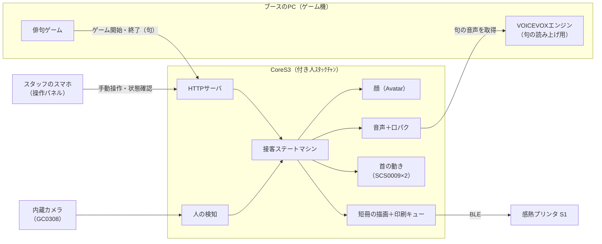
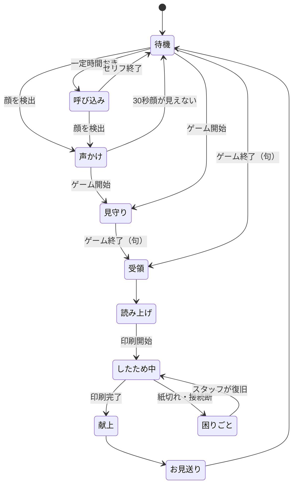

# ソフトウェア構成（接客）v0.1

付き人ｽﾀｯｸﾁｬﾝに、次の2つの接客をさせる。
1. **ゲーム前の客寄せ**：通りがかった人に声をかけ、ゲームに誘う
2. **ゲーム後の短冊の手渡し**：ゲームで詠まれた句を受け取り、読み上げ、短冊に印刷して手渡す

---

## 1. 全体構成



- ロボットは**ゲームの中身を知らなくてよい**。ゲームからは「始まった」「終わった（＋句）」の2種類の知らせだけを受け取る
- PCやネットが落ちても、**客寄せと定型セリフは単体で動き続ける**（句の読み上げだけ省略する）

---

## 2. 接客の流れ（ステートマシン）



| 状態 | 顔 | 首 | 声（例） | 抜ける条件 |
|---|---|---|---|---|
| 待機 | 通常、ときどきまばたき | ゆっくり左右を見渡す | — | 人を検知／ゲーム開始・終了／呼び込みの時刻 |
| 呼び込み | 笑顔 | 正面 | 「一句詠んでいくのだ！」 | セリフが終わる |
| 声かけ | 笑顔 | **顔の方を向き、目で追う** | 「そこのお方、俳句ゲームはいかがなのだ？」（2人以上なら「おふたりで…」） | ゲーム開始／30秒顔が見えない |
| 見守り | 通常 | ゲーム画面の方を見る | ときどき「がんばるのだ！」 | ゲーム終了 |
| 受領 | 驚き→笑顔 | 少し上を向く | 「をかし！素敵な句なのだ！」 | すぐ次へ |
| 読み上げ | 口パク | 句の区切りで小さく頷く | 句そのもの（VOICEVOX） | 読み終わる（PCがなければ省略） |
| したため中 | 伏し目 | **文机の方を向く** | 「いま、短冊に書いているのだ」 | 印刷完了／エラー |
| 献上 | 笑顔 | 正面に戻って**お辞儀** | 「できたのだ！持って帰ってほしいのだ！」 | セリフが終わる |
| お見送り | 笑顔 | 正面 | 「またきてほしいのだ〜」 | セリフが終わる |
| 困りごと | 悲しい | 小刻みに首を振る | 「紙がなくなっちゃったのだ…」 | スタッフ画面で「復旧」を押す |

**優先順位**：ゲーム終了 ＞ ゲーム開始 ＞ 人の検知 ＞ 呼び込み。
たとえば呼び込みの最中にゲームが終わったら、セリフを途中で止めて受領に移る。

**しつこくしない工夫**
- 声かけの後は60秒間、同じ位置にいる顔には声をかけ直さない
- 呼び込みは30〜60秒おきに、ランダムな間隔で行う。同じセリフは続けて使わない
- スタッフ画面の「静かモード」で、呼び込みと声かけを止められる（隣のブースへの配慮用）

---

## 3. モジュール構成（CoreS3 側）

| モジュール | 役割 | 実装のポイント |
|---|---|---|
| `Brain`（接客） | 上のステートマシン。イベントを受けて各モジュールに指示を出す | イベントは FreeRTOS のキューで受け取る。状態ごとに「入ったとき」「毎フレーム」「出るとき」の処理を書く |
| `Face` | 平安顔の表情 | 実装済み（[HeianFace.h](../src/HeianFace.h)）。「驚き」の表情を追加する |
| `Voice` | 定型セリフと、句の読み上げの再生＋口パク | 定型セリフは埋め込み済みの仕組みを拡張し、**カテゴリごとに複数のセリフからランダムに選ぶ**。句の音声は PC の VOICEVOX から WAV を受け取り、PSRAM に置いて再生する |
| `Motion` | 首の動き（見渡す・人を向く・文机を見る・お辞儀・頷く） | SCS0009 を半二重シリアルで動かす（中継基板は [StackChan/docs/servo_board.md](../../StackChan/docs/servo_board.md)）。急に動かさないよう、速度に上限を付ける |
| `Presence` | 内蔵カメラで顔を検出し、人の有無・方向・人数を出す | 下の「人の検知」を参照 |
| `Net` | Wi-Fi 接続、HTTP サーバ、`tsukibito.local` という名前で見つかるようにする（mDNS） | 4章の API を提供。スタッフ画面の HTML も CoreS3 から配る |
| `Printer` | 短冊の描画と印刷キュー | 句を 384px 幅の白黒画像に描き（明朝・縦書き、docs/decoration.md 4章）、BLE で S1 に送る。印刷中に次の句が来たら**最大5件まで待ち行列に積む** |
| `Config` | 設定 | microSD の `config.json`：Wi-Fi、PC のアドレス、音量、呼び込みの間隔など |
| `Log` | 記録 | 印刷枚数、エラー、時刻だけを記録する。**句や名前は保存しない** |

**プリンタは差し替えられるようにする**。`Printer` は「画像を渡すと印刷する」という窓口だけを持つ形にして、その裏側の実装を入れ替えられるようにする。
- 案1：CoreS3 から S1 へ BLE で直接送る（第一候補）
- 案2：S1 が ESP32 から制御できなかった場合は、解析済みの別のプリンタに替える
- 案3：PC 側に BLE で送る中継役を置く

### 人の検知：内蔵カメラだけで行う
外付けセンサは使わず、CoreS3 内蔵のカメラ（GC0308）で**顔を検出**する。
（内蔵の近接センサ LTR-553 は数cmしか測れないので、人の検知には使えない）

**カメラにする利点**
- 追加の部品が要らない
- **顔の方向が分かる** → その人の方へ首を向け、話している間は目で追える（客寄せで一番効く演出）
- 正面を向いた顔だけに反応するので、「ロボットを見ている人」にだけ声をかけられる。前を素通りする人には声をかけない
- 人数が分かる（「おふたりでどうぞなのだ」のように言い分けられる）

**仕組み**
- 320×240（QVGA）で撮影し、ESP32-S3 用の顔検出（esp-dl の human_face_detect）にかける。arduino-esp32 2.x の `CameraWebServer` サンプルに入っているものと同じ
- 顔の位置から首の角度を計算して、パン（左右）とチルト（上下）を少しずつ合わせる
- 首を大きく動かしている最中は画像がぶれるので、検出しない
- 処理が重いので、待機中は1秒に2〜5回程度に落とす。読み上げ中と印刷中は止める

**限界と対策**
| 限界 | 対策 |
|---|---|
| 顔が小さく写る遠い人（約2m以上）は検出できない | ブースの前1〜2mが対象なので問題ない。遠くの人は定期的な呼び込みで拾う |
| 後ろ姿や横顔は検出できない | 「こちらを見た人」に声をかける設計なので、むしろ都合がよい |
| 暗い会場では検出率が下がる | 明るさを事前に確認する。必要なら灯台の LED を顔の照明に兼用する |
| CPU とメモリの負荷（顔の描画・音声・Wi-Fi・BLE と同時に動く） | PSRAM を使い、検出の頻度を状態ごとに切り替える。**最初に負荷を測る試作をする**（8章 S0） |

**プライバシー**
- 画像は CoreS3 の中で顔の位置を出すのに使うだけ。**保存も送信もしない**
- 高札（案内板）に「カメラは顔の位置の検出にのみ使い、録画・保存はしません」と書いておく

**カメラの位置の注意**：カメラは CoreS3 の前面上部にある。烏帽子のクリップ、襟、装束の布でカメラを隠さないこと（docs/enclosure.md 6章のチェック項目に追加）。

---

## 4. ゲームとの連携 API

ゲームのプログラムに足してもらうのは、**HTTP で JSON を送る処理だけ**にする。

### `POST http://tsukibito.local/event`
**ゲーム開始**
```json
{ "type": "game_start" }
```
**ゲーム終了**（印刷の依頼）
```json
{
  "type": "game_end",
  "haiku": { "kami": "古池や", "naka": "蛙飛び込む", "shimo": "水の音" },
  "name": "芭蕉",
  "reading": "ふるいけや かわずとびこむ みずのおと",
  "score": 85
}
```
- `name`（詠み人）、`reading`（読み上げ用のかな）、`score`（点数）は省略してよい
- `reading` があると読み間違いを防げる（「蛙＝かわず」など）
- `score` があれば、点数によって褒め方を変える（例：80点以上で「をかし！」、それ未満は「よき句なのだ」）

返答は `{"accepted": true, "queue": 1}` のように返す。`queue` は印刷待ちの件数。

### `GET http://tsukibito.local/status`
```json
{ "state": "したため中", "printer": "connected", "queue": 0, "printed_today": 42, "quiet": false }
```

### 試し方（ゲームがまだなくても試せる）
```bash
curl -X POST http://tsukibito.local/event -H 'Content-Type: application/json' -d '{"type":"game_end","haiku":{"kami":"古池や","naka":"蛙飛び込む","shimo":"水の音"},"name":"芭蕉"}'
```

---

## 5. スタッフ画面（スマホ）

`http://tsukibito.local/` を開くと出る、CoreS3 が配る1枚のページ。

| 項目 | 内容 |
|---|---|
| 状態表示 | 今の状態、プリンタの接続、印刷待ちの件数、今日の印刷枚数、電池残量 |
| 手動で印刷 | 上五・中七・下五・名前を入力して印刷（ゲームの連携がうまくいかないときの保険） |
| 静かモード | 呼び込みと声かけを止める |
| 復旧 | 紙を交換した後に押すと、止まっていた印刷を再開する |
| テスト | テスト印刷、各セリフの再生、お辞儀の動作 |
| 音量 | スライダー |

CoreS3 の画面を**3秒長押し**したときも、IPアドレスと状態を表示する（スマホがつながらないときの確認用）。
来場者が頭をなでる（画面に短くタッチする）と、「くすぐったいのだ！」と反応する。

---

## 6. ネットワーク（会場）

会場の Wi-Fi は当てにしない。

| 構成 | 内容 | 判定 |
|---|---|---|
| A. スマホのテザリングかモバイルルーター | ロボット・PC・スタッフのスマホを同じネットワークにつなぐ | **推奨** |
| B. CoreS3 がアクセスポイントになる | ルーターが要らない。ただし PC はインターネットにつながらなくなる | 予備 |

どちらの構成でも `tsukibito.local` で見つかるようにしておく。mDNS が使えない端末向けに、IP アドレスは画面の長押しで確認できる。

---

## 7. セリフ（カテゴリと数）

[voice/phrases.json](../voice/phrases.json) に `category` を足し、同じカテゴリの中からランダムに選ぶ。

| カテゴリ | 数 | 例 |
|---|---|---|
| attract（呼び込み） | 5 | 「一句詠んでいくのだ！」「俳句で遊べるのだ〜」 |
| greet（声かけ） | 3 | 「そこのお方、俳句ゲームはいかがなのだ？」 |
| game_start | 2 | 「がんばるのだ！」 |
| cheer（見守り中） | 3 | 「いい感じなのだ」 |
| praise_high / praise | 各3 | 「をかし！」／「よき句なのだ！」 |
| writing | 2 | 「いま、短冊に書いているのだ」 |
| handover | 2 | 「できたのだ！持って帰ってほしいのだ！」 |
| farewell | 2 | 「またきてほしいのだ〜」 |
| touch | 2 | 「くすぐったいのだ！」 |
| trouble | 3 | 「紙がなくなっちゃったのだ…」「墨をすっているのだ…」 |

全部で約30セリフ、1つ3秒として約3MB。今のファームウェアへの埋め込み方式のままで入る（アプリ領域は6MB）。
数が増えたら microSD に移せば、セリフを変えるたびに書き込み直す必要がなくなる。

---

## 8. 実装の順番

| Step | 内容 | 確認方法 |
|---|---|---|
| S0 | **カメラの試作**：顔検出が、顔の描画・音声と同時にどれくらいの速さで動くかを測る | 画面に顔を出したまま、検出回数と人の位置がシリアルに出る |
| S1 | `Brain` の骨組みと `Voice` のカテゴリ化。イベントはシリアルとタッチで仮に発生させる | シリアルに `end` と打つと、受領 → 献上の流れが通る |
| S2 | `Motion`：首の基本動作（見渡す・文机を見る・お辞儀・頷く） | 各状態で首が動く |
| S3 | `Net`：Wi-Fi、HTTP API、スタッフ画面 | 4章の curl で流れが通る |
| S4 | `Presence`：顔を検出して声をかけ、首で追う | 前に立って顔を向けると、こちらを向いて声をかけてくる |
| S5 | `Printer`：短冊の描画（まずは画面に表示して確認）→ BLE で印刷 | ※ S1 プリンタの解析（concept.md の Step 0）が先に必要 |
| S6 | 句の読み上げ（PC の VOICEVOX から取得） | ゲーム終了で句を読み上げる |
| S7 | 会場向けの強化：自動再接続、ウォッチドッグ、3時間の連続稼働テスト | 半日放置しても止まらない |

S0〜S4 はプリンタがなくても進められる。S0 で負荷が大きすぎると分かった場合だけ、安価な人感センサ（M5Stack Unit PIR）を予備として検討する。プリンタの解析（S5の前提）と並行して進めるのがよい。

---

## 9. 決めること・確認すること
- [ ] **ゲームの形態**：PC アプリか、ブラウザか、スマホか。HTTP で JSON を送れるか（ゲーム担当の人に、4章の API 仕様を渡して確認する）
- [ ] ブースに PC はあるか（句の読み上げに VOICEVOX を使うため）
- [ ] 来場者の名前を短冊に入れるか（入れる場合も、ロボット側には保存しない）
- [ ] 会場の騒がしさ（スピーカーの音量で足りるか、外付けスピーカーが要るか）
- [ ] 会場の明るさ（顔検出の精度に影響する）
